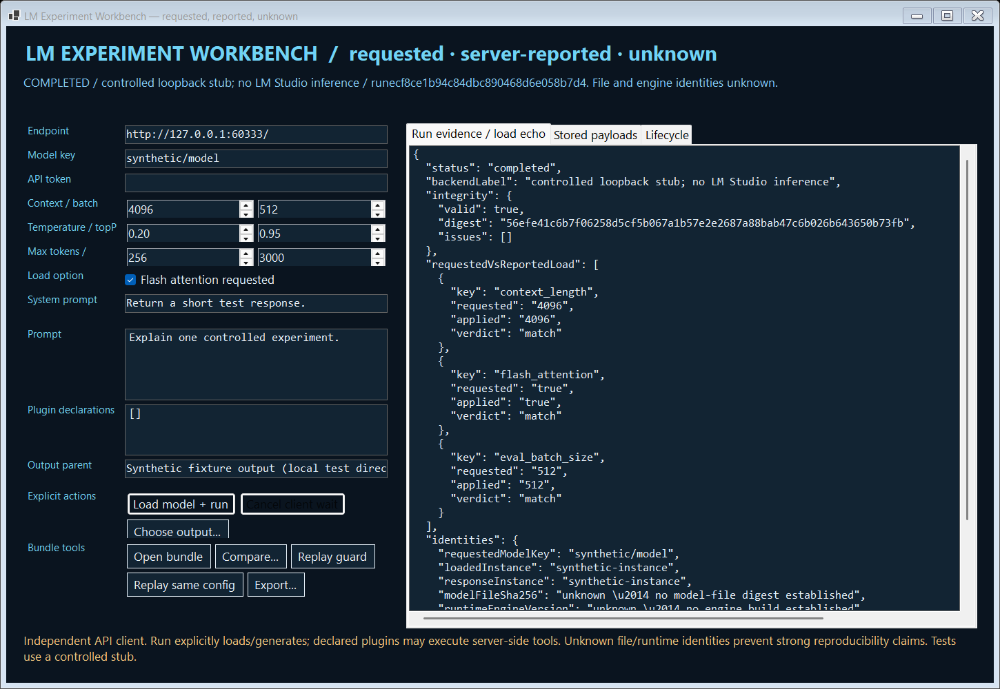

# LM Experiment Workbench

Save what you asked a local AI server to do, what it reported back, and what it did not tell you. Compare two runs without confusing the settings you requested with the settings the server actually confirmed.

You change a response setting and get a better answer. Later you want to repeat it, but cannot remember the complete request or whether the same model settings were actually loaded. A screenshot of a settings panel leaves many of those questions unanswered.

**Example:** The saved examples change one requested response setting, temperature, which controls sampling randomness. The comparison shows that requested difference separately from the replies. It also leaves missing model or runtime details marked unknown, rather than claiming that the setting alone caused the different answer.

**What you install:** A separate Windows app designed to connect to LM Studio running on your computer.

**Current scope:** The Windows app was tested with a program pretending to be an LM Studio server. A real LM Studio model run has not been verified. No model is bundled, and the results shown here are not a speed or answer-quality benchmark.

[Live guide](https://az9713.github.io/rea-lmstudio-experiments/) · [Download packages](https://github.com/az9713/rea-lmstudio-experiments/releases/tag/v0.1.0)




## Use the Windows app

Download `LM-Experiment-Workbench-win-x64.zip`, extract it, and run **experiment-workbench.exe**. GUI, CLI and .NET runtime are included. Keep the extracted files together. No global SDK installation or cloud API account is required. Windows compatibility was tested on the build machine, not a version/hardware matrix.

1. Independently enable a compatible LM Studio native v1 local server. Enter its loopback base URL, such as `http://127.0.0.1:1234/`, and the exact model key known to that server. Nothing is probed at app startup.
2. Enter requested context length, evaluation batch, Flash Attention, temperature, top-p, maximum output tokens, timeout, system prompt and prompt. Choose the output parent directory explicitly if the portable default is unsuitable.
3. If required, enter an API token in the masked field. It is passed as an Authorization header, never put into the experiment specification, and cleared from the UI after the attempt. Do not embed credentials in prompts or plugin declarations.
4. Press **Load model + run**. This explicitly lists models, loads the exact key with `echo_load_config=true`, then chats using the returned instance identifier. Loading/generation changes backend state. Declared MCP plugins can execute server-side tools.
5. Inspect requested/reported load checks, identities, stored payloads and lifecycle. A successful HTTP run can still have missing or differing settings. Those facts remain visible; success does not mean all requested settings were applied.
6. **Cancel client wait** records client cancellation. It does not assert backend cancellation or unload models. When closing during a run, the app requests cancellation and waits for the local terminal record before closing; crashes, power loss and filesystem failure can still interrupt publication.
7. Use **Open bundle**, **Compare**, **Replay guard**, **Replay same config**, or **Export**. Opening/guarding/comparing alone sends no request. Replay checks current requested factors before another explicit load/chat; plugin replay is blocked.

The native v1 API already supplies load echoes, model metadata, chat statistics and MCP response items. This client adds a durable evidence and comparison layer; it does not claim to invent API observability. [Official API overview](https://lmstudio.ai/docs/developer/rest), [version-pinned load contract](https://github.com/lmstudio-ai/docs/blob/8c7159be3ffe364af10aa8ae6f5a7570e9402089/1_developer/2_rest/load.md).

## Exact, reported, and unknown

| Evidence | Meaning |
|---|---|
| Stored load/chat request bytes | Exactly the JSON body sent by this client; its digest is committed in the manifest |
| Server load configuration | Server-reported echo, including any extra fields in the stored response; not a hardware measurement |
| Selected requested/applied checks | Context, Flash Attention and evaluation batch; missing means unknown, not assumed applied |
| Models response | Metadata snapshot before loading: key, architecture/format/quantization/size when provided |
| Loaded/chat instance IDs | API identifiers checked for consistency, not model-file fingerprints |
| Model-file SHA-256 | **Unknown**; no installed model file is opened |
| Engine/runtime build | **Unknown** through this implemented API contract |
| Applied inference configuration | **Unknown in full**; requested temperature/top-p/etc are recorded but a full sampler/runtime echo is not inferred |
| Tool schemas/implementation hashes | **Unknown**; plugin IDs and allowed-tool declarations do not pin code or schemas |
| Chat output/tool calls/statistics | Stored response evidence; synthetic fixture statistics are not performance measurements |

Headers, cookies and credentials are excluded from request records. Exact-body hashes do not cover the Authorization header. Valid JSON responses are retained exactly unless credential redaction is needed; those artifacts are labeled redacted. Non-JSON or unsupported-depth bodies are omitted before persistence, and oversized responses fail without saving a partial body. Known credential values/fields and Bearer strings are redacted. Arbitrary undisclosed or encoded secrets cannot be guaranteed detected. Prompts, outputs, tool arguments/results and model metadata can be sensitive: review before sharing exports.

## Immutable bundle format

Each run publishes to a new random ID directory. Payloads are written with create-new semantics in an owned staging directory, flushed, then renamed into place. The app never overwrites a published run. Immutability here is an application contract plus tamper detection, not a filesystem access-control guarantee.

Typical successful bundle:

```
spec.json
models-response.json
load-request.json
load-response.json
chat-request.json
chat-response.json
outcome.json
manifest.json
manifest.sha256
```

Failed, timed-out and canceled bundles contain the available subset plus specification and outcome. `outcome.json` records lifecycle times, terminal state, whether backend completion remains unknown, configuration checks and identity limits. Every payload's length, digest and representation is committed. The companion digest commits the exact manifest bytes.

Verification checks schema, required roles, safe leaf names, file budgets, exact directory membership and payload hashes. Selected directories and payload files cannot be links. Linked ancestors, concurrent filesystem replacement and hostile local-process behavior are outside protection. Limits:2MiB/artifact,20artifacts,64KiB manifest,JSON depth40. An adjacent checksum can be regenerated by an attacker who rewrites everything. Keep the manifest digest independently for stronger rewrite detection. There are no signatures, trusted timestamps or authenticity claims.

## One-factor comparison and replay guards

Compare flattens requested configuration into leaf fields, including nested plugin declarations. It reports zero, one or multiple changes; endpoint, model key, prompt and timeout are factors too. The user-declared backend label is descriptive metadata and is excluded. Observed outcome/load/instance differences are shown separately. “Exactly one requested field changed” is **not** proof that only one physical factor changed, that a performance difference is causal, or that runtime/model state was controlled.

Configuration replay requires a verified completed bundle, unchanged requested factors, matching available load echoes and no plugins. It rechecks the new server load echo before chat, aborting if settings differ or are missing; the model may already be loaded. An incomplete/canceled run, changed prompt/settings, or declared tool integration also blocks replay. Allowed replay still warns about unknown model/runtime identities, hardware state, sampling and output determinism. Temperature zero would not itself establish bitwise reproducibility. The guard does not authenticate a backend or independently verify the companion checksum's origin.

## Plugin scope

The native API uses **integrations**, not arbitrary custom function-tool schemas. This workbench accepts only explicit installed-plugin declarations such as:

```json
[{"type":"plugin","id":"mcp/your-plugin","allowed_tools":["your_tool"]}]
```

Default is `[]`. Remote ephemeral-MCP URLs and credential fields are rejected. Even a local plugin can perform remote or mutating work on the backend; loopback-only client networking does not constrain the plugin implementation. Review its side effects before explicitly running. Returned tool-call arguments/results are captured as response evidence. The controlled stub only returns synthetic tool items and never executes a real tool.

## CLI

```powershell
.\experiment-cli.exe --stub-demo .\new-demo-parent
.\experiment-cli.exe --self-test .\new-test-output
.\experiment-cli.exe --verify .\RUN_ID
.\experiment-cli.exe --verify .\RUN_ID INDEPENDENT_MANIFEST_SHA256
.\experiment-cli.exe --compare .\BASELINE_ID .\VARIANT_ID
.\experiment-cli.exe --guard .\RUN_ID
.\experiment-cli.exe --run .\spec.json .\new-runs-parent
```

`--stub-demo` owns a temporary loopback server and writes two synthetic runs differing only in temperature. It performs no inference. `--run` is the explicit real-backend action; it prompts for an optional token without echoing it. Redirected input runs without a token. No token file or environment-variable token is read. Exit codes:0 success,2 invalid bundle/failed run,1 exception,64 usage. Comparison/guard output is structured JSON: inspect its validity/allowed verdict rather than treating exit0 as a replay/comparability proof.

The GUI diagnostic mode writes real HTTP test evidence and actual native render screenshots:

```powershell
.\experiment-workbench.exe --self-test C:\YOUR_WORKSPACE\new-ui-output
```

It uses only its owned loopback stub; no installed service is contacted. Use a fresh directory.

## Build and verification

Prerequisites: Windows x64, PowerShell, Python3 and public Microsoft download access. No npm is used. Scripts bootstrap a project-local .NET SDK9.0.320 and verify SHA512 against official metadata. `EXPERIMENT_DOTNET` may instead point to an existing workspace-contained portable SDK. Project-local temp/cache/CLI-home redirection and disabled development-certificate generation precede SDK use.

```powershell
.\scripts\build.ps1 -Publish
.\scripts\test.ps1
.\scripts\package.ps1
```

**33 tests** use real HttpClient interaction with a controlled TCP loopback server. They cover exact request/body persistence, credential transport/redaction, echoed/missing/differing configs, live replay checks, numeric echo representations, bounded responses, disabled redirects/proxies, malformed responses, timeout/cancellation, a backend that finishes after client timeout, instance mismatch, requested-factor comparison, plugin replay blocking, tamper/anchor/traversal/extra-entry checks and export preservation. Native renders and fixture-explorer/browser checks supplement these tests. Published and extracted self-contained executables are smoke-tested separately. No real LM Studio inference, runtime-version parity, tool execution, GPU performance or installed-build compatibility was tested.

Source/binary packaging uses an explicit public-file manifest with project-bound path assertions, excludes caches/private baselines/debug symbols, and includes Microsoft notices. Bit-for-bit compiler/dependency reproducibility is not claimed.

## License

[MIT](LICENSE), original client code. [NOTICE.md](NOTICE.md) and Microsoft runtime notices apply. No LM Studio code/model is distributed. This research prototype is not endorsed by LM Studio; review outputs and exports before relying on them.
